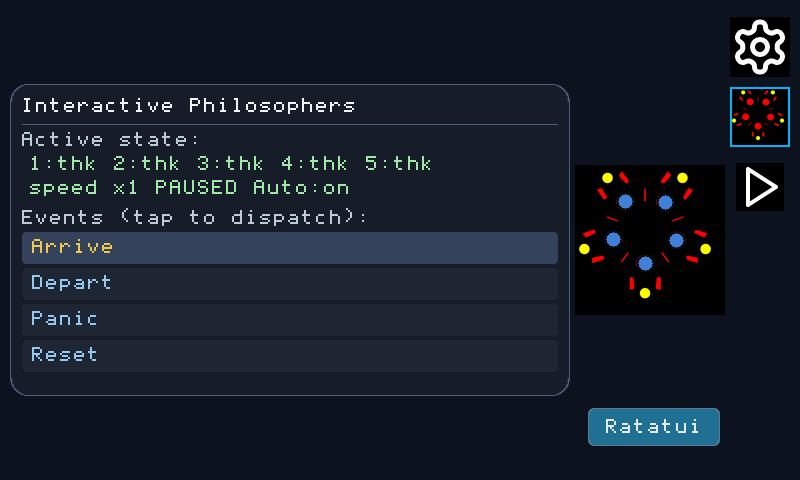

<!--
README.md - Index for the Ratatui on rlvgl progressive tutorial.
-->

# Ratatui on rlvgl — Rust All the Way Down

This tutorial builds a Ratatui interface that is also a native rlvgl widget.
The worked SCTD example uses the host simulator and the
STM32H747I-DISCO bare-metal display stack. There is no C LVGL, terminal
emulator, C HAL, FFI display shim, or host font rasterizer in the embedded
path.

The worked example is the Dining Philosophers hero from the State Chart
Tutorial Demo (SCTD). The original screen draws the table with native rlvgl
graphics. Pressing its **Ratatui** button opens a second presentation:

- rlvgl draws the rounded window, title bar, close button, and action buttons;
- Ratatui composes the live table inside the window; and
- `RatatuiView` rasterizes Ratatui's retained cells through the same rlvgl
  renderer used by the native controls.



The captures and board statements below describe the recorded SCTD execution.
The owned bridge migration requires fresh checks of its exact source and
packages; historical captures do not qualify a new dependency pin or target.

## What you will build

| Stage | Result |
|---|---|
| End of Chapter 1 | A `no_std + alloc` Ratatui terminal backed by `RlvglBackend` |
| End of Chapter 2 | A retained cell surface that an rlvgl widget can paint safely |
| End of Chapter 3 | A hybrid window with native rlvgl chrome around Ratatui content |
| End of Chapter 4 | A live Ratatui view driven by presentation snapshots from the state machine |
| End of Chapter 5 | A host and bare-metal validation workflow with evidence tied to the checked source |

## The two composition directions

The bridge deliberately supports both directions at once:

```text
Ratatui application
    │ Terminal<RlvglBackend>
    ▼
RatatuiSurface (retained cells)
    │ shared handle
    ▼
RatatuiView (an rlvgl Widget)
    │
    ├── fullscreen content, or
    └── one pane inside native rlvgl chrome and controls
            │
            ▼
rlvgl Renderer → framebuffer → display
```

Ratatui owns cell composition. rlvgl owns widget-tree composition, clipping,
input dispatch, and the physical display path. The retained surface is the
ownership boundary between them; the backend never borrows a framebuffer or a
renderer.

## Why this is different

`ratatui-rlvgl` is not a binding to C LVGL and it does not translate Ratatui
cells into C-driver conventions. The embedded path is Rust from the generated
application state through the UI and down to the display controller:

```text
iState-generated Rust machine
  → Ratatui widgets
  → ratatui-rlvgl
  → rlvgl widget tree and renderer
  → Rust DMA2D / LTDC / DSI platform code
  → STM32H747I-DISCO panel
```

The host simulator changes only the last platform layer. That makes it the
fastest development and capture target without turning the host build into a
different application.

## Prerequisites

- A stable Rust toolchain for the host chapters.
- This rlvgl checkout if you want to follow the exact SCTD example.
- The `thumbv7em-none-eabihf` Rust target and an STM32H747I-DISCO for the
  optional hardware chapter.

The bridge crate is `no_std + alloc`. The owned maintenance source uses
`crates/ratatui-rlvgl` in RLVGL and native `ratatui-core` from official,
unmodified Ratatui 0.30.2 at
`e665c36cb14752a61cd777fbd06dbef8474f2add`. This supersedes the historical
coordinated fork/facade recipe; no upstream bridge contribution is required.

For a consumer of the owned 0.1.2 package **after publication**, the normalized
registry dependencies are:

```toml
[dependencies]
ratatui-core = { version = "=0.1.2", default-features = false }
ratatui-rlvgl = { version = "0.1.2", default-features = false }
rlvgl-core = { version = "0.2.7", default-features = false }
```

The native core package version 0.1.2 and upstream Ratatui release 0.30.2 refer
to different packages. Inside this checkout, the demo manifests use the owned
bridge and pinned native core paths. Use one native core type identity;
packaged consumers must not fall back to source/vendor paths. These examples
do not assert that the maintenance package has already been published.

The chapters use `ratatui_core` primitives and the scoped owned
`ratatui_rlvgl::compat` panel/text helpers. They do not require the upstream
`ratatui` facade or `ratatui-widgets` on the target-neutral path. On targets
without pointer atomics, enable `portable-atomic` and forward it to native core
and the bridge as the demo manifests do. Supply an allocator and the existing
board-specific atomic support; do not generalize C3's single-core assumption
or claim hardware qualification from a host-only check.

## Reference implementation

The tutorial follows these files:

- [`crates/ratatui-rlvgl/`](../../crates/ratatui-rlvgl/) —
  bridge crate;
- [`examples/apps/sctd-demo/src/ratatui_hero.rs`](../../examples/apps/sctd-demo/src/ratatui_hero.rs)
  — hybrid hero and Ratatui table widget;
- [`examples/apps/sctd-demo/src/lib.rs`](../../examples/apps/sctd-demo/src/lib.rs)
  — controller, state snapshots, native controls, and modal lifecycle;
- [`examples/disco-sim/src/sctd_main.rs`](../../examples/disco-sim/src/sctd_main.rs)
  — host wrapper; and
- [`examples/stm32h747i-disco/src/main.rs`](../../examples/stm32h747i-disco/src/main.rs)
  — established bare-metal runtime with the SCTD payload selected by feature.

## Chapters

| Ch | Title | Main idea |
|---|---|---|
| [1](01-backend-and-surface.md) | Backend and surface | Construct a Ratatui terminal without a terminal emulator |
| [2](02-rendering-cells.md) | Rendering retained cells | Map cell geometry, colors, modifiers, glyphs, and dirty regions to pixels |
| [3](03-hybrid-window.md) | Hosting a Ratatui pane | Compose native rlvgl chrome and controls around a `RatatuiView` |
| [4](04-live-state.md) | Driving the live table | Feed presentation snapshots to Ratatui without coupling it to machine internals |
| [5](05-host-and-bare-metal.md) | Host and bare metal | Verify on the simulator, then prove the same stack on STM32H747I-DISCO |

For the larger state-chart and generated-UI construction, continue with the
[State Chart → Reactive UI tutorial](../sctd-tutorial/README.md). This series
starts at the UI bridge rather than repeating that pipeline.

---

**Next →** [Chapter 1 — Backend and surface](01-backend-and-surface.md)
